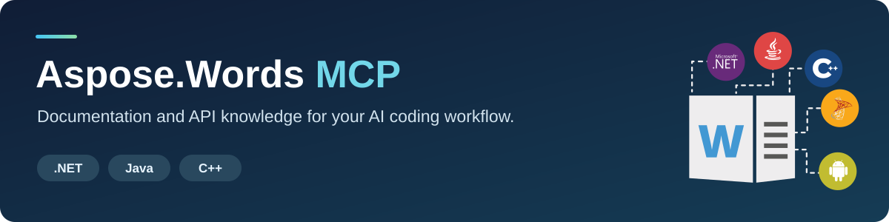
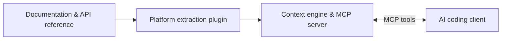

  

  <strong>Bring Aspose.Words documentation and API reference into your AI coding workflow.</strong> 
  Self-hosted Model Context Protocol (MCP) servers, extraction plugins, and GitHub Copilot agents for .NET, Java, and C++ developers.

  <a href="#start-here">Get started</a> ·
  <a href="https://github.com/aspose-words-mcp/net-client-copilot-agent/blob/main/showcase/runs/published-01/showcase.md">Explore example answers</a> ·
  <a href="https://docs.aspose.com/words/">Documentation</a> ·
  <a href="https://reference.aspose.com/words/">API reference</a>

## Start here

Choose your platform, deploy its MCP server, then connect your AI client to the endpoint supplied by your deployment. The .NET and Java Copilot agents include VS Code configuration and compilation-check workflows for generated examples.

| Platform | Deploy an MCP server | Connect GitHub Copilot | Explore the extraction plugin |
| :--- | :--- | :--- | :--- |
| **.NET** | [net-server](https://github.com/aspose-words-mcp/net-server) | [Setup guide](https://github.com/aspose-words-mcp/net-client-copilot-agent/blob/main/docs/setup.md) · [Agent repository](https://github.com/aspose-words-mcp/net-client-copilot-agent) | [net-plugin](https://github.com/aspose-words-mcp/net-plugin) |
| **Java** | [java-server](https://github.com/aspose-words-mcp/java-server) | [Setup guide](https://github.com/aspose-words-mcp/java-client-copilot-agent/blob/main/docs/setup.md) · [Agent repository](https://github.com/aspose-words-mcp/java-client-copilot-agent) | [java-plugin](https://github.com/aspose-words-mcp/java-plugin) |
| **C++** | [cpp-server](https://github.com/aspose-words-mcp/cpp-server) | Connect an MCP-compatible client using the server instructions | [cpp-plugin](https://github.com/aspose-words-mcp/cpp-plugin) |

**Your first prompt:** “How do I convert a DOCX document to PDF using Aspose.Words?” Specify your platform so the client can retrieve the relevant documentation and APIs.

## How it works

The plugins prepare platform-specific documentation and API content. The shared [context engine](https://github.com/aspose-core-mcp/context-engine) provides ingestion, indexing, retrieval, and MCP infrastructure. Server repositories combine pinned engine and plugin versions for self-hosted deployment; client agents use the tools to retrieve evidence and cite documentation in their answers.

## Explore real examples

**[Browse 99 .NET example answers →](https://github.com/aspose-words-mcp/net-client-copilot-agent/blob/main/showcase/runs/published-01/showcase.md)**

Explore document conversion, reporting, editing, and other Aspose.Words tasks. The accompanying [run metrics](https://github.com/aspose-words-mcp/net-client-copilot-agent/blob/main/showcase/runs/published-01/metrics.md) report compilation outcomes, repairs, model usage, and timing.

Working with Java? The [Java showcase runner](https://github.com/aspose-words-mcp/java-client-copilot-agent/blob/main/showcase/README.md) includes 99 questions and a workflow for generating and checking answers against your deployment.

## Documentation and support

- **Learn Aspose.Words:** [Product overview](https://products.aspose.com/words/) · [Developer documentation](https://docs.aspose.com/words/) · [API reference](https://reference.aspose.com/words/).
- **Report an MCP issue:** open an issue in the relevant server, plugin, or client repository above. Include the platform, version, and a minimal reproduction; remove credentials and private endpoint details.
- **Explore ingestion sources:** [Documentation source](https://github.com/aspose-words-mcp/docs) · [API reference source](https://github.com/aspose-words-mcp/reference).

---

Aspose.Words MCP · .NET · Java · C++

